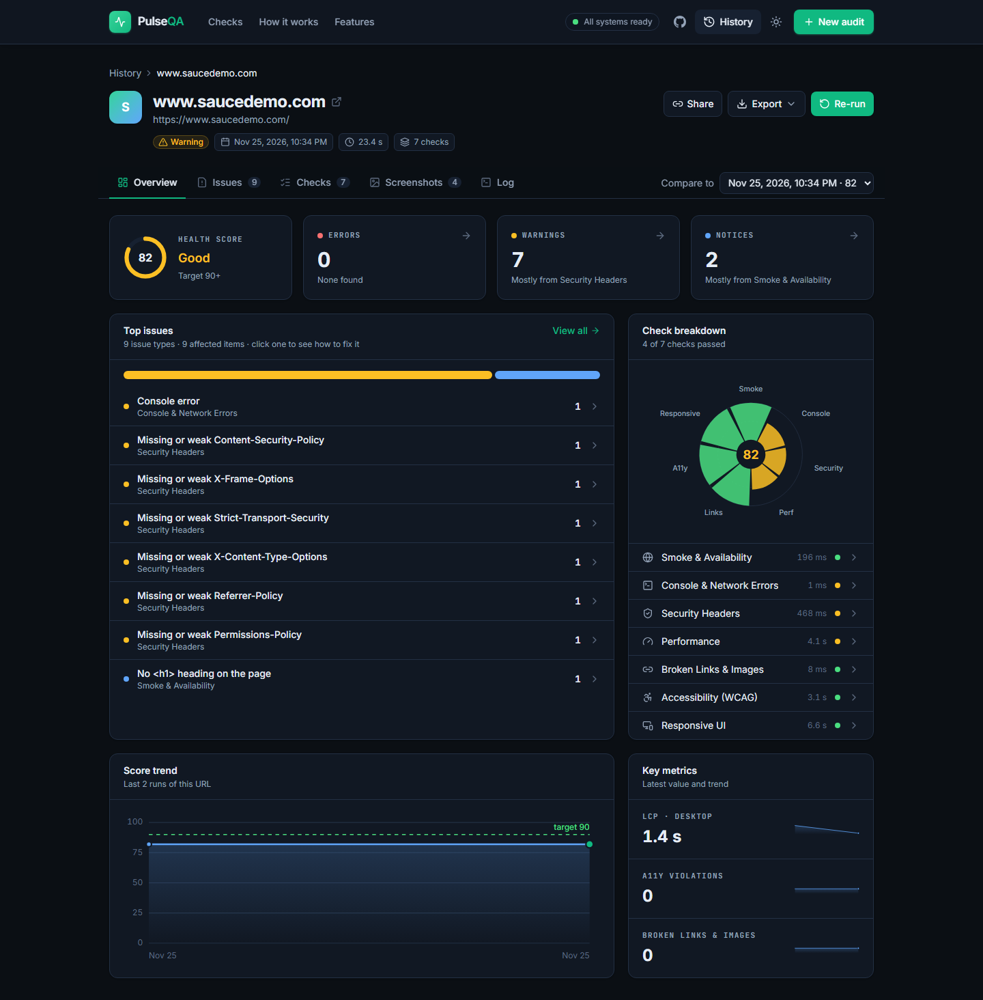
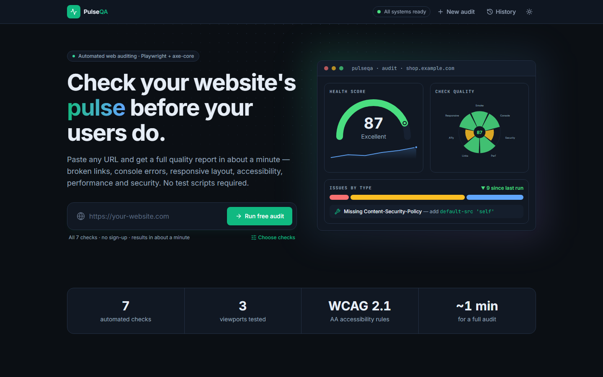
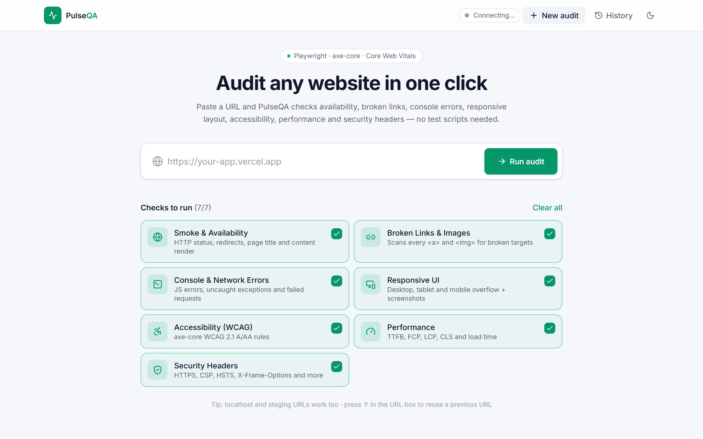
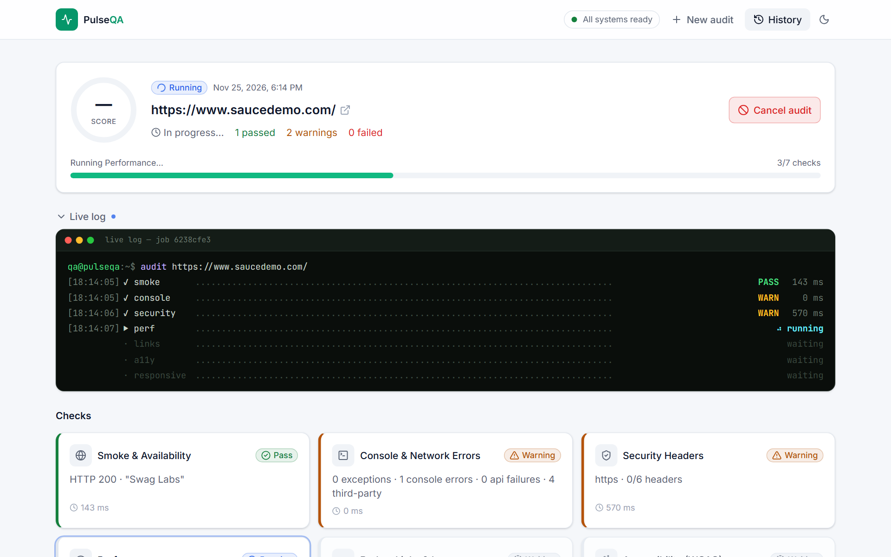
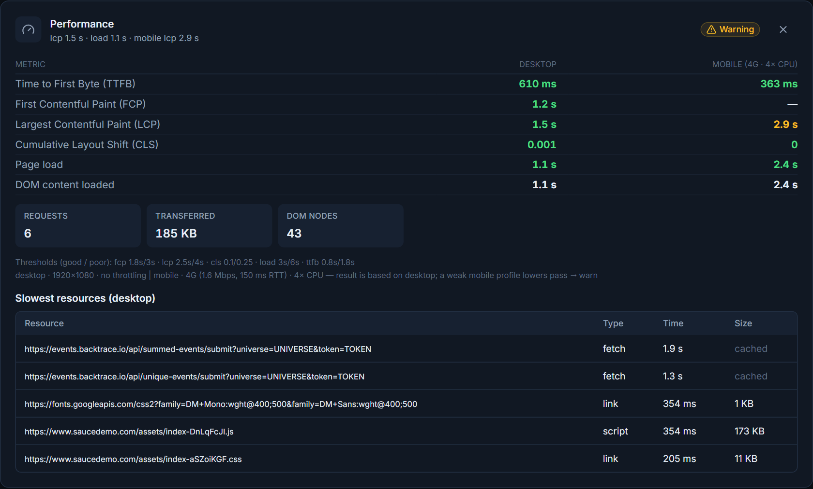
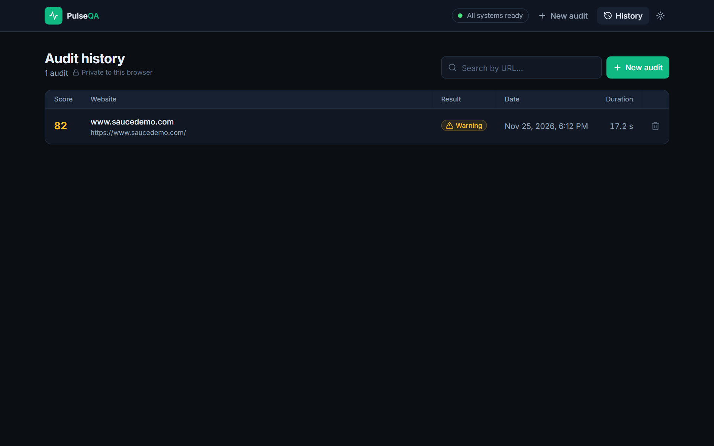
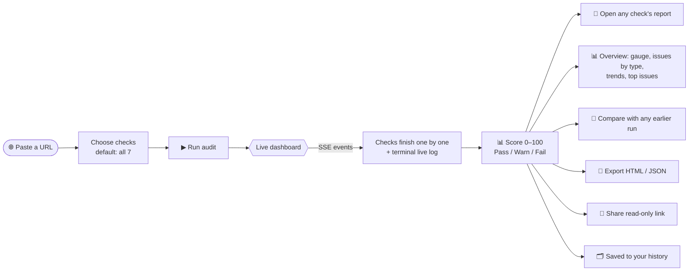
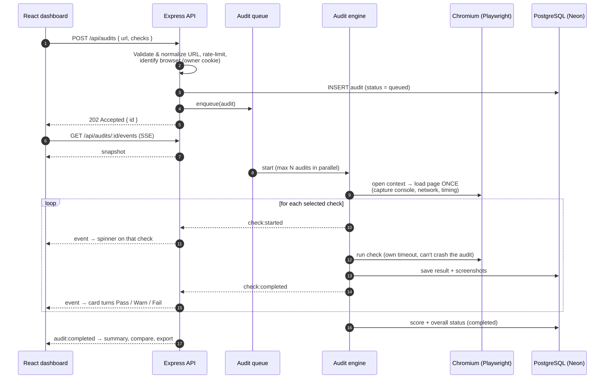
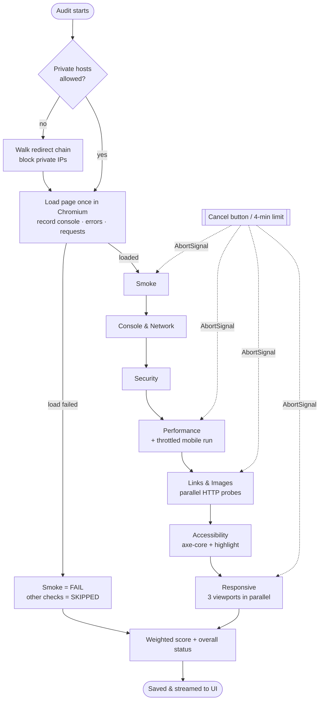
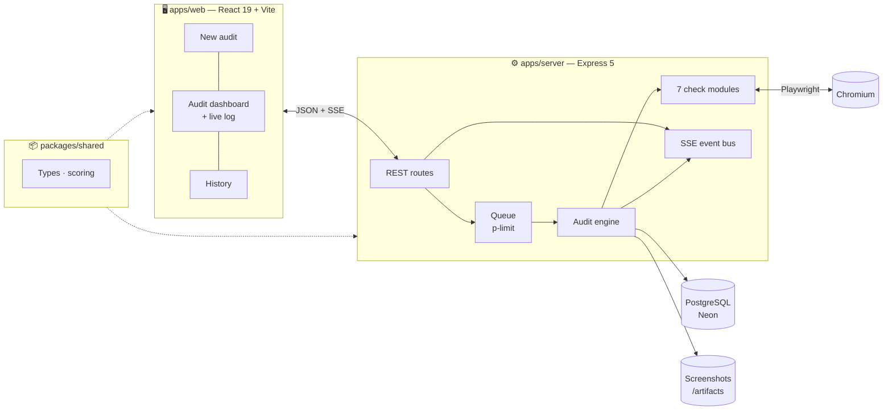

<div align="center">

# ⚡ PulseQA

### Automated Web Auditing &amp; E2E Test Execution Platform

Paste any URL → get a full quality report in seconds.<br/>
**Availability · Broken links · Console errors · Responsive layout · Accessibility · Performance · Security** — no test scripts required.




</div>

---

## 📑 Contents

- [Why PulseQA?](#-why-pulseqa)
- [Features](#-features)
- [Screenshots](#-screenshots)
- [How it works — the workflow](#-how-it-works--the-workflow)
- [The 7 checks in detail](#-the-7-checks-in-detail)
- [Architecture](#-architecture)
- [Privacy & security model](#-privacy--security-model)
- [Getting started](#-getting-started)
- [Configuration](#-configuration)
- [API reference](#-api-reference)
- [Testing](#-testing)
- [Deployment](#-deployment)
- [Roadmap](#-roadmap)

---

## 💡 Why PulseQA?

Every web app needs the same baseline quality checks before release — is it up, are links broken, does it throw errors, does it break on mobile, is it accessible, is it fast, is it secure? Doing that by hand (or writing a test script for every new project) is slow and easy to skip.

**PulseQA runs all of it automatically against _any_ URL** using a real Chromium browser, streams the progress live, stores every run, and compares each run with the previous one so you can see what **regressed** or got **fixed**.

---

## ✨ Features

| | |
|---|---|
| 🔍 **7 automated checks** | Smoke, links & images, console & network, responsive, accessibility (WCAG 2.1 AA), performance (Core Web Vitals), security headers |
| ⚡ **Live progress** | Server-Sent Events stream each check as it finishes, with a terminal-style live log |
| 📱 **Desktop + mobile** | 3 viewports (1920 · 768 · 375 px) with screenshots; throttled mobile performance profile (4G, 4× CPU); accessibility scanned on desktop **and** mobile |
| 🎯 **Low-noise results** | First-party vs third-party error split, bot-protection detection, HEAD→GET fallback, clipped-overflow detection |
| 📊 **Overview dashboard** | Health-score gauge, issues by type (errors / warnings / notices), per-check polar chart, KPI trend sparklines and a ranked *Top issues* list |
| 🛠️ **How-to-fix tips** | Every issue comes with remediation guidance — what to change, where it was found, a copy-paste example (e.g. a ready CSP header) and a docs link — in the dashboard and the exported report |
| 🔁 **Regression tracking** | Pick any earlier run of the same URL in *Compare to* — score and issue deltas, **NEW** issue badges, fixed issues |
| 📄 **Export & share** | Self-contained HTML report (screenshots embedded), raw JSON, or a read-only share link |
| ⛔ **Cancel & time limits** | Cancel any running audit; hard 4-minute ceiling per audit; per-check timeouts |
| 🔒 **Private by default** | No login needed — each browser only sees its own latest 10 audits (anonymous, hashed owner ID; older runs auto-pruned) |
| 🛡️ **Safe to host publicly** | SSRF guard on every navigation, redirect and link probe; rate limiting; duplicate-run protection |
| 🚀 **Landing page** | Product landing page at `/` with a one-click *Run free audit* box (advanced options at `/new`) |
| 🌗 **Light / dark UI** | Clean dashboard with a live terminal panel, mobile-friendly |

---

## 📸 Screenshots

### Landing page



| Start an audit | Live progress |
|---|---|
|  |  |

### Overview dashboard


| Detailed report (Performance: desktop vs throttled mobile) | Private history |
|---|---|
|  |  |

---

## 🔄 How it works — the workflow

### 1. The user journey



### 2. What happens behind the scenes



### 3. Inside the audit engine



**Key design decisions**

- **One page load, many checks** – smoke, console/network, security, performance and accessibility all reuse the same loaded page, so a full audit costs one navigation instead of seven.
- **Failure isolation** – each check runs with its own timeout inside a `Promise.race`; one crashing check becomes `error` while the rest of the audit continues.
- **One shared browser** – parallel viewports and the mobile performance run are lightweight *contexts* inside a single Chromium process, keeping memory low on small servers.
- **Cancellable everywhere** – one `AbortSignal` (user cancel + overall timeout) flows through the engine, checks and HTTP probes, and closes browser contexts immediately.

---

## 🧪 The 7 checks in detail

| Check | What it does | Fails when |
|---|---|---|
| 🌐 **Smoke & Availability** | HTTP status, redirect chain, page title, blank-page detection, viewport meta, above-the-fold screenshot. SEO notes (meta description, favicon, `lang`, `<h1>`) are informational. | 4xx/5xx, blank page |
| 🔗 **Broken Links & Images** | Collects every `<a>` and ``, probes up to 150 links / 100 images (12 parallel, 4 per host) with browser-like headers, HEAD → GET fallback, redirects followed manually. 401/403/429 are reported as *restricted* (bot protection), not broken. | Broken internal link or any broken image |
| 🖥️ **Console & Network** | Uncaught exceptions, `console.error`, failed XHR/fetch and other failed requests — split into **first-party** and **third-party** (ads, analytics). Only first-party problems can fail. | First-party exception or failed API call |
| 📱 **Responsive UI** | Loads the page at desktop 1920×1080, tablet 768×1024 and mobile 375×812 in parallel, detects real horizontal scrolling (ignores clipped overflow), lists offending elements, full-page screenshots. | Horizontal overflow on any viewport |
| ♿ **Accessibility** | axe-core with WCAG 2.0/2.1 A + AA rules on **desktop (1920×1080) and mobile (375×812, touch, mobile UA)** in parallel; problems that only mobile users hit (e.g. icon-only menu links) are reported separately. Violations grouped by impact, with how-to-fix links and screenshots that **outline the failing elements**. | Any critical or serious violation on either viewport |
| 🚀 **Performance** | TTFB, FCP, LCP, CLS, load time, request count, transfer size, slowest resources — on desktop **and** a throttled mobile profile (1.6 Mbps, 150 ms RTT, 4× CPU, like Lighthouse). | A desktop metric above the "poor" threshold |
| 🛡️ **Security Headers** | HTTPS, HTTP→HTTPS redirect, CSP, X-Frame-Options / `frame-ancestors`, HSTS, X-Content-Type-Options, Referrer-Policy, Permissions-Policy, mixed content, cookie flags, server info leaks. | No HTTPS or mixed content |

**Issue severity (Overview):** every finding is grouped into an *issue* and ranked — **errors** (e.g. broken images, first-party exceptions, critical/serious a11y, poor Core Web Vitals, no HTTPS), **warnings** (moderate a11y, missing security headers, broken external links, console errors) and **notices** (minor a11y, SEO notes, bot-protected links, third-party noise).

**Remediation:** each issue carries a short fix (`packages/shared/src/remediation.ts`) — e.g. *Missing Content-Security-Policy* → a starter `Content-Security-Policy: default-src 'self'; …` header plus where to set it (helmet, Nginx, Vercel/Netlify, Cloudflare); accessibility issues reuse axe-core's per-element advice and the offending HTML.

**Scoring:** each check has a weight (smoke 3, security 1, others 2). Pass = 100 %, Warn = 50 %, Fail/Error = 0 %, Skipped is excluded. The overall result is the worst check status.

---

## 🏗️ Architecture



| Layer | Tech |
|---|---|
| Frontend | React 19, Vite, TypeScript, Tailwind CSS v4, TanStack Query, React Router, lucide icons |
| Backend | Node.js, Express 5, TypeScript (tsx), Zod validation, express-rate-limit |
| Browser automation | Playwright (Chromium), @axe-core/playwright, Chrome DevTools Protocol throttling |
| Database | PostgreSQL on Neon, Drizzle ORM + migrations |
| Live updates | Server-Sent Events |
| Testing | Vitest, Supertest, Playwright against local fixture sites |

```
pulseqa/
├── apps/
│   ├── server/
│   │   ├── src/
│   │   │   ├── audit/
│   │   │   │   ├── checks/        # smoke, links, consoleNetwork, responsive, accessibility, performance, security
│   │   │   │   ├── engine.ts      # page load, check orchestration, timeouts, cancellation
│   │   │   │   ├── runner.ts      # persistence + live events
│   │   │   │   ├── queue.ts       # concurrency limit + cancel switches
│   │   │   │   └── browser.ts     # shared Chromium, contexts, SSRF route guard, throttling
│   │   │   ├── routes/audits.ts   # REST + SSE endpoints
│   │   │   ├── lib/               # URL guard (SSRF), owner cookie, site (1st/3rd party)
│   │   │   └── db/                # Drizzle schema + client
│   │   ├── drizzle/               # SQL migrations
│   │   └── test/                  # unit, API and browser integration tests + fixture pages
│   └── web/src/
│       ├── pages/                 # NewAudit, AuditDetail, History
│       ├── components/            # Overview dashboard, SVG charts, check reports, UI kit
│       └── lib/                   # API client, SSE hook, compare, export
└── packages/shared/               # types, scoring + issue classifier shared by server and web
```

---

## 🔐 Privacy & security model

**No login, still private.** Each browser receives a random 256-bit secret in an `httpOnly` cookie. The database stores **only its SHA-256 hash**, so a database leak can't be used to impersonate anyone.

| Action | Who can do it |
|---|---|
| See an audit in **History** | Only the browser that created it |
| Open an audit **by link** | Anyone with the link (read-only view, shown as "Shared report") |
| **Cancel / delete** an audit | Only its owner (others get `403`) |
| See **trends & run comparison** | Only the owner |

**Hardening for public hosting**

- **SSRF protection** (`ALLOW_PRIVATE_HOSTS=false`): the target, every redirect hop, every browser request and every link probe is checked; anything resolving to localhost / private / link-local ranges is blocked.
- **Rate limiting:** 10 new audits per minute per client; identical audits already running are de-duplicated.
- **Resource limits:** max concurrent audits, per-check timeouts, 4-minute audit ceiling, capped link/image counts and screenshot heights.

---

## 🚀 Getting started

### Prerequisites

- **Node.js 20+** (developed on Node 24)
- A **PostgreSQL** database — a free [Neon](https://neon.tech) project works great

### Setup

```bash
# 1. Install dependencies
npm install

# 2. Download the Chromium browser used for audits
npm run playwright:install

# 3. Configure environment
cp .env.example .env        # then paste your Neon connection string into DATABASE_URL

# 4. Create the database tables
npm run db:migrate

# 5. Start API (:4000) + dashboard (:5173)
npm run dev
```

Open **http://localhost:5173**, paste a URL and press **Run audit**.

> **Windows note:** if the project folder name contains `&`, npm's `.cmd` shims break. The scripts already work around this by calling each tool's JS entry with `node`. Renaming the folder (e.g. `PulseQA`) avoids the issue entirely.

### Scripts

| Command | Description |
|---|---|
| `npm run dev` | API (watch mode) + web dashboard together |
| `npm test` | Unit, API and browser integration tests |
| `npm run typecheck` | Type-check server and web |
| `npm run build` | Production build of the web app |
| `npm start` | Start the API (also serves the built web app) |
| `npm run db:generate` | Create a migration after changing `apps/server/src/db/schema.ts` |
| `npm run db:migrate` | Apply migrations |

---

## ⚙️ Configuration

Set in `.env` at the project root (see [`.env.example`](.env.example)).

| Variable | Default | Description |
|---|---|---|
| `DATABASE_URL` | — | PostgreSQL connection string (**required**) |
| `PORT` | `4000` | API port |
| `MAX_CONCURRENT_AUDITS` | `2` | Audits that run at the same time (others wait in the queue) |
| `HISTORY_LIMIT` | `10` | Audits kept per browser — when a new one starts, the oldest finished ones (and their screenshots) are deleted |
| `ALLOW_PRIVATE_HOSTS` | `true` | Allow auditing localhost / private networks. **Set `false` when hosting publicly.** |
| `ARTIFACTS_DIR` | `./artifacts` | Where screenshots are stored |
| `CORS_ORIGIN` | `http://localhost:5173` | Allowed web origin(s), comma-separated |
| `CROSS_SITE_COOKIES` | `false` | `true` only if the web app and API are on different sites |
| `WEB_DIST_DIR` | `../web/dist` | Built web app served by the API (single-service deploy) |

---

## 📡 API reference

| Method | Endpoint | Description |
|---|---|---|
| `POST` | `/api/audits` | Start an audit `{ url, checks? }` → `202` (or `200` with `deduplicated: true`) |
| `GET` | `/api/audits?page=&limit=&q=` | Your history (filter by URL with `q`) |
| `GET` | `/api/audits/:id` | Audit with all results and screenshots (`isOwner` flag) |
| `GET` | `/api/audits/:id/events` | Live progress stream (SSE) |
| `GET` | `/api/audits/:id/history` | Completed runs of the same URL up to this one — scores + summaries for trends (owner only, `[]` for others) |
| `GET` | `/api/audits/:id/previous` | Previous completed run of the same URL (owner only) |
| `POST` | `/api/audits/:id/cancel` | Cancel a queued/running audit (owner only) |
| `DELETE` | `/api/audits/:id` | Delete an audit and its screenshots (owner only) |
| `GET` | `/api/health` | API, database and queue status |

**SSE events:** `snapshot` · `audit:started` · `check:started` · `check:completed` · `audit:completed` · `audit:failed`

---

## ✅ Testing

```bash
npm test
```

**31 tests** across three levels:

- **Unit** – URL validation & SSRF IP ranges, first/third-party site detection, scoring, performance thresholds.
- **API** – validation, ownership & privacy rules (403s, scoped history, owner-only trends), de-duplication, cancel/delete rules, rate limiting (Supertest, DB mocked).
- **Browser integration** – the real engine runs against local **fixture websites**: a deliberately broken page (broken link & image, JS exception, failed API call, mobile overflow, missing alt text, low contrast, no HTTPS) must be caught and ranked as errors in the Overview; a clean page must pass with zero errors; plus third-party noise, unreachable hosts, SSRF blocking, cancellation and the time limit.

---

## ☁️ Deployment

Simplest option — **one service** serves both the API and the dashboard (so the privacy cookie works without extra setup):

```bash
npm install
npm run playwright:install   # or use the official Playwright Docker image
npm run build                # builds apps/web/dist
npm run db:migrate
npm start                    # API + dashboard on $PORT
```

Production checklist:

- [ ] `ALLOW_PRIVATE_HOSTS=false`
- [ ] `DATABASE_URL` points to your Neon (or other Postgres) database
- [ ] Persistent disk (or object storage) for `ARTIFACTS_DIR`
- [ ] A host that can run Chromium (e.g. Render, Railway, Fly.io, a VPS — not serverless functions)

---

## 🗺️ Roadmap

- [x] **Step 1 — Generic URL audits** (this release)
- [ ] **Step 2 — App-specific E2E suites:** Playwright Page Object Model tests for your own apps — user journeys, auth, form validation, CRUD, regression and cross-browser (Chromium / Firefox / WebKit)
- [ ] **Step 3 — Backend & load:** REST API testing and lightweight load testing (k6)
- [ ] CI integration — run audits from GitHub Actions with a score threshold

---

<div align="center">

Built with TypeScript, Playwright and a lot of ☕

</div>
